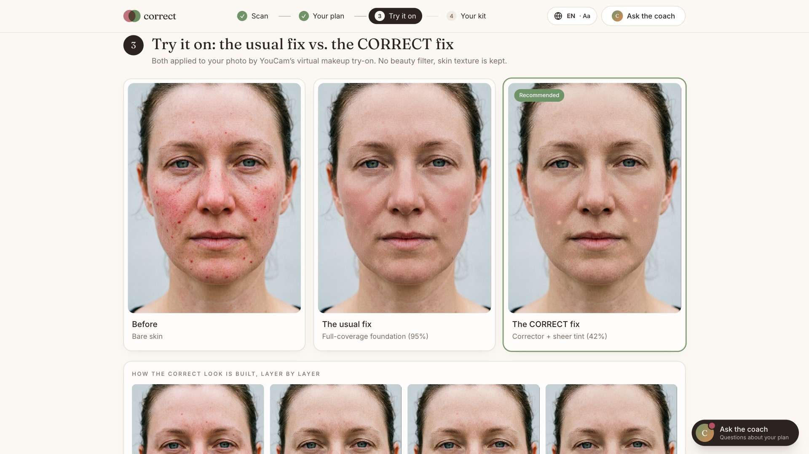
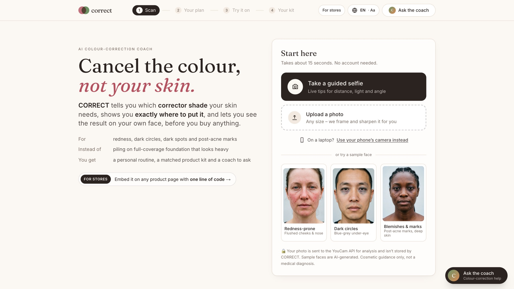
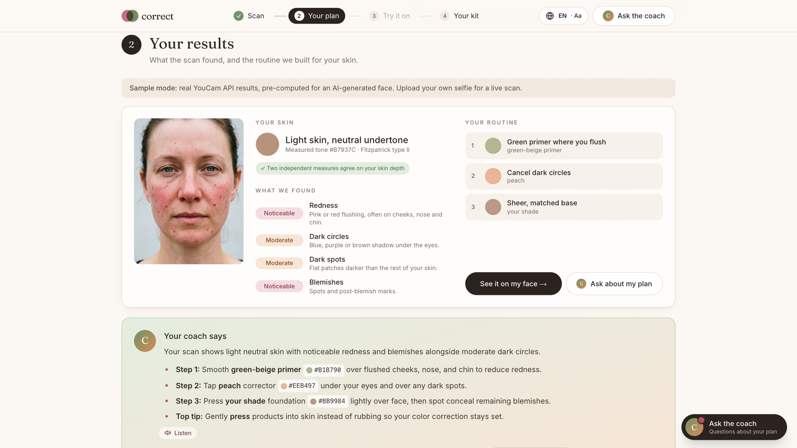
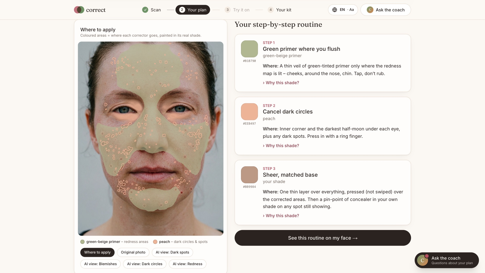
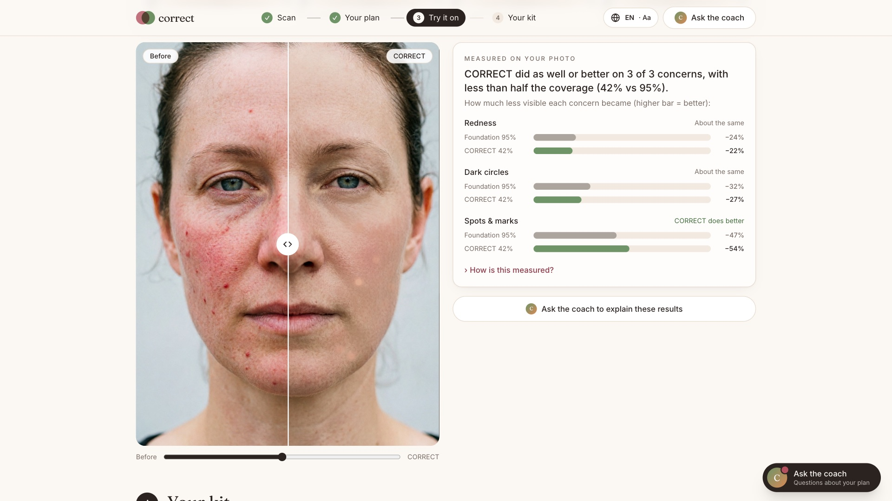
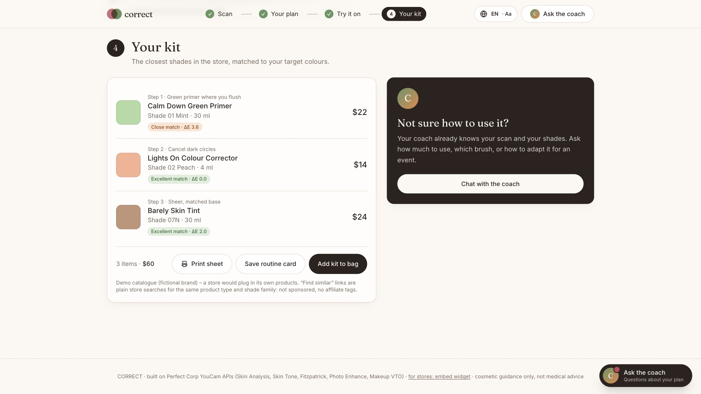
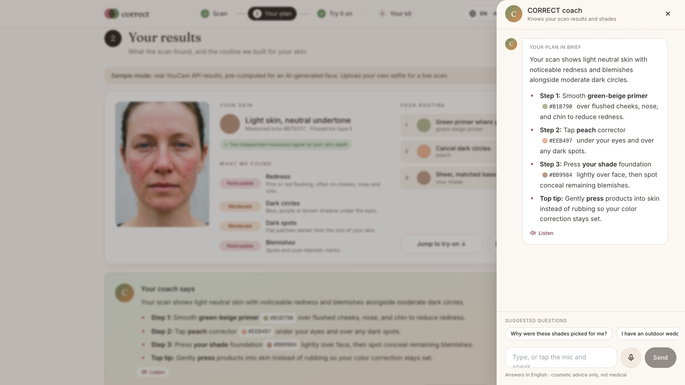
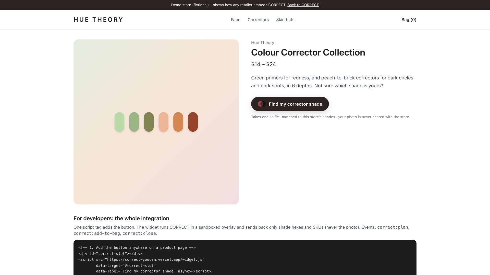
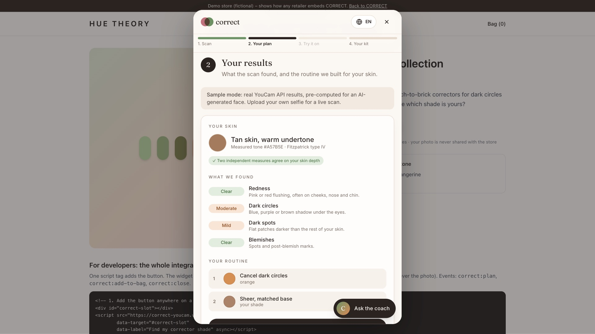
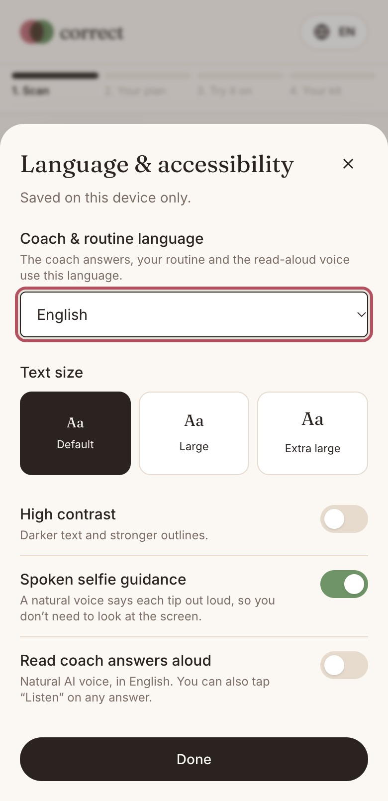

# CORRECT — cancel the colour, not your skin

**An AI colour-correction coach built on the YouCam Skin AI and Makeup VTO APIs.** One selfie tells you which
colour corrector your skin needs, shows exactly where to put it, renders the routine on your own face, and matches it
to real products, in any store, in 11 languages.

| | |
|---|---|
| 🌐 **Live app** | **https://correct-youcam.vercel.app** (phone or desktop, installable PWA, no sign-up) |
| 🎬 **Demo video** | **https://youtu.be/SchSyX8BlOo** (2:54) |
| 🛍️ **Live sample store** | **https://correct-youcam.vercel.app/store-demo**: CORRECT embedded in a store page with one `<script>` tag |
| 🧪 **YouCam APIs** | Skin Analysis HD · Skin Tone Analysis · Fitzpatrick Skin Type · AI Photo Enhance · Makeup VTO · AI Image Generator |
| 📄 **License** | MIT |



### For judges: 60-second test
1. Open the live app and click a **sample face**. It costs no credits and you can explore everything.
2. Or tap **Take a guided selfie** (live, spoken tips for distance, light and head angle; it captures automatically), or **Upload a photo** of any size.
3. Click **See it on my face** to compare full-coverage foundation with the CORRECT layering on your own photo, with measured results.
4. Ask the **coach** (bottom right) anything about your plan, by typing or by voice, in any of 11 languages, and tap **Listen** to hear the answer. Then save your **routine card** or print a **client sheet**.
5. Open **[/store-demo](https://correct-youcam.vercel.app/store-demo)**, click **Find my corrector shade**, pick a sample, then **Add kit to bag**: the store's own SKUs go into its cart, and the photo never leaves CORRECT.

## The problem

People with redness (rosacea-prone skin), dark under-eye circles or post-acne marks usually try to hide them with *more* foundation. The result looks heavy and the colour still shows through. Makeup artists use **colour correction** instead: the complementary colour cancels the discolouration, so a sheer base is enough.

- Green cancels red.
- Peach, orange or red-orange cancels blue-violet shadow and grey-brown marks.

The hard part is the shade. A corrector that works on fair skin turns ashy on deep skin. Most shoppers don't know which one to buy, or where to put it.

CORRECT handles that end to end:

1. **Maps where your skin needs correction.** YouCam Skin Analysis (HD) returns per-concern scores and **masks** for redness, dark circles, dark spots and blemishes. CORRECT decodes those masks into a *dab map* drawn in your corrector colours.
2. **Picks the corrector for your depth and undertone.** YouCam Skin Tone Analysis gives your measured skin colour. CORRECT converts it to CIELAB, computes the **Individual Typology Angle (ITA°)** for skin depth and the hue angle for undertone, then chooses from a 6-depth corrector table. YouCam's **Fitzpatrick Skin Type** model is an independent cross-check. If the two disagree by 2+ bands (usually because lighting skewed the colour), the model wins. On all three sample faces the two measures agreed: II = Light, IV = Tan, VI = Rich deep.
3. **Shows it on your face, layer by layer.** It makes up to four YouCam Makeup VTO calls: a full-coverage baseline, then a **chained** green primer → warm corrector → sheer tint, where each pass is applied on top of the previous pass's result URL.
4. **Measures the result honestly.** In the browser it measures, inside the YouCam-flagged zones, how visible each concern still is: the **ΔE colour difference** between the flagged area and the skin around it. It compares the corrected look against full-coverage foundation and highlights whichever did better, **even when it's the foundation**.
5. **Builds a kit and answers questions.** Shades are matched to a store catalogue by **CIEDE2000**. A **Gemini** coach answers follow-ups ("outdoor wedding?", "over active breakouts?") using your actual scan data.

> Cosmetic guidance only — not a medical diagnosis.

## Why it matters

- **For shoppers:** you can't swatch a corrector online, and most colour-correction advice is written for fair skin. CORRECT gives a shade matched to *your* depth and undertone, shows where it goes, and shows the result on your own face before you buy. That means fewer wrong purchases and less heavy makeup.
- **For retailers:** one `<script>` tag adds a "Find my corrector shade" button to any product page. One selfie becomes a matched basket from the store's own catalogue (`correct:add-to-bag` event with SKUs), which means higher conversion on a hard-to-sell category and fewer returns. The shopper's photo is never sent to the store.
- **For makeup artists:** a printable client sheet with before/after photos, the map, shades with hex codes, and products.

## Screenshots

| | |
|---|---|
|  **Start:** guided selfie, any upload, or a sample face |  **Results:** YouCam Skin Analysis HD concerns, measured tone + Fitzpatrick type, the routine |
|  **Colour map:** YouCam masks turned into a where-to-apply map, in the real shades |  **Try it on:** YouCam Makeup VTO, the usual full-coverage fix vs. the CORRECT layers |
|  **Measured honestly:** how visible each concern still is, at less than half the coverage |  **Your kit:** shades matched to the catalogue with CIEDE2000, plus print sheet and routine card |
|  **Coach:** knows your scan; voice in and out; 11 languages |  **Sample store:** CORRECT added with one script tag |
|  **In the store:** CORRECT runs in a sandboxed overlay and returns SKUs |  **Phone/PWA:** language, text size, high contrast, spoken guidance |

## How CORRECT meets the judging criteria

| Criterion | What we built |
|---|---|
| **Technological implementation** | **6 YouCam APIs** in one pipeline: Skin Analysis HD (4 concerns + masks), Skin Tone, Fitzpatrick, Photo Enhance, and Makeup VTO (chained foundation/concealer/smoothing layers), plus Text-to-Image for the sample faces. Masks are decoded pixel by pixel, renders are measured in CIELAB, and the CIEDE2000 matching is unit-tested against published reference data. On-device MediaPipe face detection; credit guard (rate limits + daily cap); response caching. |
| **Design** | 11 languages, voice in and out, text size, high contrast, spoken camera guidance, phone hand-off by QR code, offline samples, printable client sheet. A guided flow (Scan → Your plan → Try it on → Your kit) with a scroll-aware step tracker, guided selfie camera, results-at-a-glance card, plain-language explanations, before/after slider, shareable routine card, coach drawer, installable PWA, WCAG-minded focus/keyboard/screen-reader support. |
| **Potential impact** | A specific, under-served audience (rosacea-prone skin, dark circles, dark marks on deeper skin) for whom "more foundation" fails. The app shows the outcome on the user's own face and measures it, so the claim can be checked. Store value: one selfie becomes a matched basket from the store's own catalogue, and the **one-line embeddable widget** puts it on any product page. |
| **Quality of idea** | It uses the Skin AI *masks* (where), not just scores (how much), to drive a *Makeup VTO* routine, so Skin AI and VTO work as one. It encodes makeup-artist colour theory scaled by ITA°/Fitzpatrick depth, and designs around API realities we discovered (default smoothing, spot-only concealer, HD size and face-fraction limits). |

## Made for a wider audience

| Who | What CORRECT does for them |
|---|---|
| **People who don't read English** | 🌐 Pick a language (11, including Spanish, Portuguese, Hindi, Arabic, Indonesian, Chinese, Japanese and Korean; it follows the browser language on first visit). The coach answers in it, and the written routine is translated by Gemini (cached). The coach also replies in whatever language you type in. |
| **Low-vision users, low literacy, hands busy with makeup** | 🔊 **Listen** reads any coach answer aloud in a natural AI voice (server-side text-to-speech, falling back to the device voice), or turn on auto-read. 🎤 **Ask by voice**: the question is recorded in the browser and transcribed verbatim on the server, so it works in every browser (Chrome, Safari, Firefox, Brave). |
| **Taking a selfie without seeing the screen** | The guided camera **speaks its tips** in a natural pre-recorded voice ("Move a little closer", "Too dark – face a window"), buzzes when the pose is right, and auto-captures. |
| **Laptop users with poor webcams** | **"Use your phone's camera instead"** shows a QR code that opens CORRECT on the phone with the guided camera already open. |
| **Low vision, colour-vision deficiency** | **Text size** (Default / Large / Extra large; the whole UI is in rem so everything scales), **high-contrast mode** (also follows `prefers-contrast: more`), and every colour swatch is labelled in words, including a key on the "where to apply" map. |
| **Bad connections** | The service worker caches all three sample faces after the first visit, so the full demo (map, routine, try-on, kit) works **offline**, with a clear offline banner. |
| **Shoppers who want real products** | **Find similar** links for each step search Sephora, Ulta, Amazon and Nykaa for that product type and shade family (plain searches, no affiliate tags). |
| **People tracking their skin** | **My scans over time** keeps a small history *only in the browser* (thumbnail + YouCam scores) and compares each scan with the last one per concern ("Calmer than last time"). Can be deleted at any time. |
| **Makeup artists** | **Print sheet**: a one-page A4 client sheet (before / map / after photos, skin profile, routine table with swatches and hex codes, products, coach notes, blank artist-notes lines). Use print or "Save as PDF". |
| **Retailers** | **Embeddable widget**: `<script src=".../widget.js" data-target="#slot">` adds a "Find my corrector shade" button. CORRECT runs in an overlay iframe (`/embed`) and posts `correct:plan` and `correct:add-to-bag` events with the store SKUs. **Photos are never sent to the host page.** Live example: [/store-demo](https://correct-youcam.vercel.app/store-demo). |

## Results on the three sample faces

These are AI-generated faces (YouCam text-to-image), so no real person is shown. Each was run live through the APIs, and its results ship pre-computed in `public/samples`.

| Sample | What CORRECT chose | Coverage used | Measured on the photo |
|---|---|---|---|
| Redness-prone, light skin | green-beige primer → peach under-eye → 42% tint | **42%** vs 95% | Redness a\* 19.4 → **12.6** (foundation alone: 15.2) |
| Dark circles, tan/warm skin | apricot under-eye corrector → 38% tint | **38%** vs 95% | Dark-circle visibility ΔE 8.5 → **3.9** (foundation alone: 4.9) |
| Post-acne marks, rich deep skin | brick-red corrector → 42% tint | **42%** vs 95% | Under-eye visibility ΔE 13.6 → **10.7** (foundation alone: 11.4). Raised marks: full-coverage foundation conceals texture better, and the app says so. |

## Works with any selfie: automatic photo preparation

YouCam HD Skin Analysis has strict input rules: the **short side must be at least 1080 px** and the **face must be wider than 60% of the image**. Real uploads (landscape phone shots, webcam grabs, small screenshots) often break them, which would make the API return `error_below_min_image_size` or `error_src_face_too_small`. CORRECT handles both automatically:

1. **On-device face framing.** MediaPipe BlazeFace runs in the browser (self-hosted WASM, free, about 20 ms, nothing uploaded). It finds the face and crops a 3:4 portrait so the face fills about 70% of the width. If no face is found, the user gets a clear message before any credits are spent.
2. **AI upscaling.** If the crop is still under 1080 px, the server upscales it 2× or 4× with **YouCam AI Photo Enhance** (real super-resolution, 2 credits), then Lanczos-resizes it to 1200×1600. If Enhance is unavailable, it falls back to a plain resample.
3. The app shows what it did ("framed around your face; sharpened 4× with YouCam AI Photo Enhance"). Every later step (masks, renders, measurements) uses that exact prepared image, so the layers line up.

Skin Tone Analysis runs with `face_angle_strictness_level: "low"`, because colour sampling doesn't need a perfectly frontal pose.

## Installable app (PWA)

CORRECT can be installed on phones and desktops: web manifest, maskable icons, a service worker and an "Install app" button. The app shell, sample faces and face-detector files are cached, so the samples and the UI keep working offline. `/api/*` is never cached.

## YouCam APIs used

| API | Endpoint | Used for |
|---|---|---|
| AI Skin Analysis (HD) | `task/skin-analysis` | `hd_redness`, `hd_dark_circle`, `hd_age_spot`, `hd_acne` scores + raw masks (`format: json`, `enable_mask_overlay: false`) |
| AI Skin Tone Analysis | `task/skin-tone-analysis` | measured skin hex → ITA° depth + undertone; face-quality check |
| AI Fitzpatrick Skin Type | `task/fitzpatrick-scale-analyzer` | independent model-based depth (I–VI) used to cross-check ITA° |
| AI Makeup VTO | `task/makeup-vto` | `foundation`, `concealer` and `skin_smooth` effects; one baseline + chained passes using `src_file_url` of the previous result |
| File API | `file/{feature}` | signed upload → `file_id` |
| AI Photo Enhance | `task/enhance` | 2×/4× super-resolution for low-resolution selfies, so HD analysis never rejects them |
| AI Image Generator V2 | `task/text-to-image/youcam` | generating the sample faces (`scripts/build-samples.py`) |

### Things we learned about the API, and how we designed around them

- **Makeup VTO applies `skin_smooth: 50` by default on every call.** Across a three-pass chain this compounds into an airbrushed face. CORRECT sends `skin_smooth: 0` on every pass, baseline included, so every render keeps real skin texture and the comparison is fair.
- **The `concealer` effect dabs individual detected spots; it does not paint zones.** A green concealer therefore leaves visible green dots and never reaches diffuse redness. CORRECT does what makeup artists do: a **sheer green-tinted primer** (a `foundation` layer in a green-beige shade blended toward the skin), then the base, then a pin-point of skin-shade `concealer` on any remaining spots.
- **Skin Analysis masks** are RGBA overlays: a grey dimming layer with the flagged pixels in colour (redness = red, spots and acne = cyan), while the dark-circle mask is alpha-only. `src/lib/measure.ts` decodes all of them.
- Scores run 1–100 with **higher = healthier**. CORRECT treats ≥ 85 as clear, 75–84 as mild, 62–74 as moderate and < 62 as strong.

## Architecture

```
Browser (Next.js client)                         Server routes (keys never leave the server)
─────────────────────────                         ───────────────────────────────────────────
normalise photo (≤1472px JPEG) ──────────────▶ POST /api/analyze
                                                  ├─ upload → Skin Analysis (HD, 4 concerns, masks)
                                                  ├─ upload → Skin Tone Analysis           (parallel)
                                                  └─ rules.buildPlan(skin hex, scores) → plan
decode masks → dab map (canvas)            ◀──── scores, masks (data URLs), tone, plan
"See it on my face"
  ├─ POST /api/render  baseline (95% foundation)
  └─ POST /api/render  step 1 → step 2 → step 3   (each = 1 Makeup VTO task, chained via result URL)
measure ΔE / a* in mask zones (canvas, CIELAB)
kit: CIEDE2000 match against catalogue
coach ───────────────────────────────────────▶ POST /api/coach → Gemini (round-robin keys, failover)
Listen / Ask by voice / language ────────────▶ POST /api/tts · /api/stt · /api/translate → Gemini
store page: widget.js → /embed overlay ──────▶ postMessage correct:plan / correct:add-to-bag (SKUs only)
```

- `src/lib/youcam.ts`: YouCam client (upload, start a task, poll until done). It keeps polling until each task finishes, because YouCam times out tasks that aren't polled and still charges the credits.
- `src/lib/rules.ts`: the colour-correction rule engine (concern × depth × undertone → shade, strength, coverage, layer order).
- `src/lib/color.ts`: sRGB → CIELAB, ITA°, hue-angle undertone.
- `src/lib/catalog.ts`: demo catalogue (fictional house brand) + CIEDE2000.
- `src/lib/measure.ts`: mask decoding, dab map, zone/ring visibility measurement.
- `src/lib/gemini.ts`: Gemini client with key rotation and a multi-model fallback chain (text, speech-to-text and text-to-speech); a key/model pair that hits its quota is skipped for 15 minutes.
- `public/widget.js`, `src/app/embed`, `src/app/store-demo`: the one-line store integration and the live sample store.
- `src/lib/cache.ts`: disk cache keyed by image and effect hashes, so re-running a photo doesn't spend credits again. Render results are refreshed after 100 minutes because YouCam result URLs expire after 2 hours.

**Cost per live session:** 1 Skin Analysis + 1 Skin Tone Analysis + 3–4 Makeup VTO calls. Sample mode spends no credits.

## Tests

```bash
npm test     # 13 vitest tests: colour science (sRGB→CIELAB, ITA°), CIEDE2000 vs Sharma et al. reference pairs,
             # rule engine (severity, shade choice by depth, no green on deep skin, smoothing off),
             # Fitzpatrick reconciliation, catalogue coverage (ΔE2000 < 3 across fair→rich)
```

## Credit guard (public demo)

Each live scan spends YouCam credits, so the API routes are rate-limited per visitor (8 scans, 40 renders and 40 coach messages per 10 minutes), and uncached scans have a daily cap (`DAILY_SCAN_CAP`, default 150). Repeat runs of the same photo are served from cache, and sample faces never call the API.

## Run it locally

```bash
cp .env.example .env.local   # add YOUCAM_API_KEY and GEMINI_API_KEYS
npm install                  # postinstall copies the MediaPipe WASM into public/mediapipe/wasm
npm run dev                  # http://localhost:3000
```

Environment variables:

| Var | |
|---|---|
| `YOUCAM_API_KEY` | YouCam API key (v2 endpoints use it as a Bearer token) |
| `YOUCAM_BASE_URL` | defaults to `https://yce-api-01.makeupar.com` |
| `GEMINI_API_KEYS` | comma-separated keys, used round-robin |
| `GEMINI_MODEL` | defaults to `gemini-3.5-flash` (falls back to `gemini-2.5-flash`) |

To regenerate the sample bundles against a running dev server (this spends credits):

```bash
python3 scripts/build-samples.py http://localhost:3000 redness=path/a.jpg undereye=path/b.jpg spots=path/c.jpg
```

## Privacy and limits

- Photos go to YouCam for analysis and are not stored by CORRECT, apart from a temp-dir cache on the server that saves credits on repeat runs.
- Skin Tone Analysis reads colour from a camera photo, so lighting shifts it. CORRECT lifts the foundation target by 6% to compensate for camera skin samples reading slightly dark.
- Makeup VTO renders makeup; it does not simulate texture. Raised bumps still show under any coverage, and the measurement panel says so.
- The product catalogue is a fictional demo range. A retailer would map its own SKUs.

## License

[MIT](LICENSE). The sample faces are AI-generated with the YouCam AI Image Generator; no real person is shown.
